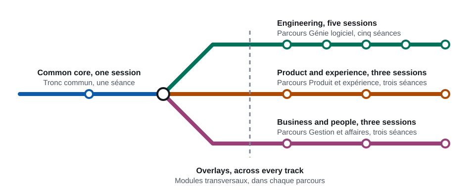

# Working with AI

Training and coaching hub

[Lire en français](#francais)

<picture>
  <source media="(prefers-color-scheme: dark)" srcset="assets/readme/program-map-dark.svg">
  
</picture>

## What this is

This is a hub of resources, shared experience and coaching for an organization that is adopting AI assistance at work. It contains a training program: one common session for everyone, then shorter sessions by role. The program teaches one way of working that holds in every role, from a first draft to a reviewed result, with a person accountable at each step.

It is for:

- people who use AI assistants at work, or soon will, whatever their role;
- presenters who deliver the sessions;
- contributors who maintain the material.

The material is organization-neutral. Examples and exercises are fictional, and the organization adds its approved tools and rules through a replaceable policy pack.

## How the material is organized

| Part | For | What it covers |
|---|---|---|
| Common core | Everyone | One session of 90 to 120 minutes with a hands-on workshop: what an assistant is, where it helps and where it fails, the working loop, context, human review, data and responsible use, agents |
| Engineering track | Developers, architects and tech leads, QA, DevOps | Five sessions: coding agents and the safe change loop, repository setup for agents, specifications, verification and security |
| Product and experience track | Product managers and owners, analysts, designers | Three sessions: from discovery to specification, delivery and design, content and data |
| Business and people track | Management, HR, business development and other roles | Two sessions on writing, research, people operations and business development, then a leadership session on adoption |
| Overlays | Every track | Working in a client environment, the local policy pack, the end-to-end engagement map |
| Resources | Everyone | Glossary, further reading, one-page handouts |

Each part is a set of module cards in the specification (`.ai/project/spec/curriculum/`). Each module becomes one French lesson in `lessons/`, under the same ID.

## Using it

### As a learner

- **Language:** the lessons, handouts and workshop packs are in Canadian French.
- **Where:** lessons are in `lessons/`, grouped by part; handouts are in `handouts/`.
- **Textbooks and decks:** a PDF textbook for the common core and for each track, and the slide decks, are built on demand. They are published as files attached to a GitHub release and are not stored in the repository.

### As a presenter

- **Speaker notes:** each lesson carries full speaker notes, written for a presenter who is new to teaching. They have complete sentences, timing marks, the transition into each checkpoint, and what to skip when running late.
- **Where:** the run of show for the common session will be in `sessions/`. The workshop packs, with presenter copies, will be in `workshops/`.
- **Before each delivery:** work through the "re-verify" list of every lesson you use, and refresh the landscape snapshot.

### As a contributor

- **Start here:** [`AGENTS.md`](AGENTS.md) holds the working rules, for people and for coding agents.
- **Where things are:**
  - the specification: [`.ai/project/spec/`](.ai/project/spec/README.md);
  - the design direction: [`DESIGN.md`](DESIGN.md);
  - the current state: [`.ai/project/state.md`](.ai/project/state.md).
- **How work happens:** changes are small and reviewed before they are committed.
- **Content:** it stays organization-neutral, and every example is synthetic.

## Status

Nothing is built yet. The repository holds the specification, the working rules and the design direction. The lessons, workshop packs, handouts, decks and textbooks come next, in the order set in [`build-order.md`](.ai/project/spec/build-order.md).

## Licence

This repository is licensed under [CC BY 4.0](https://creativecommons.org/licenses/by/4.0/). The legal code is in [`LICENSE`](LICENSE).

Copyright © 2026 [Saad Sidqui](https://saad.sidqui.ma).

Scripts that carry the header `SPDX-License-Identifier: MIT` are licensed under the [MIT licence](LICENSES/MIT.txt). Third-party material is licensed under its own stated licence; see [`THIRD_PARTY_NOTICES.md`](THIRD_PARTY_NOTICES.md).

---

# Travailler avec l’IA

Formation et accompagnement

[Read in English](#working-with-ai)

<picture>
  <source media="(prefers-color-scheme: dark)" srcset="assets/readme/program-map-dark.svg">
  
</picture>

## De quoi il s’agit

Ce dépôt est un centre de ressources, d’expériences partagées et d’accompagnement pour une organisation qui adopte l’assistance par l’IA au travail. Il contient un programme de formation : une séance commune pour tout le monde, puis des séances plus courtes selon le rôle. Le programme enseigne une même façon de travailler dans tous les rôles, de la première ébauche jusqu’au résultat révisé, avec une personne responsable à chaque étape.

Il s’adresse :

- aux personnes qui utilisent un assistant d’IA au travail, ou qui l’utiliseront bientôt, quel que soit leur rôle;
- aux personnes qui présentent les séances;
- aux personnes qui entretiennent le contenu.

Le contenu est neutre : les exemples et les exercices sont fictifs. L’organisation ajoute ses outils approuvés et ses règles au moyen d’un dossier de politiques remplaçable.

## Organisation du contenu

| Partie | Pour | Contenu |
|---|---|---|
| Tronc commun | Tout le monde | Une séance de 90 à 120 minutes avec un atelier pratique : ce qu’est un assistant, où il aide et où il échoue, la boucle de travail, le contexte, la révision humaine, les données et l’usage responsable, les agents |
| Parcours Génie logiciel | Développement, architecture et direction technique, assurance qualité, DevOps | Cinq séances : agents de programmation et cycle de modification sûr, configuration d’un dépôt pour les agents, spécifications, vérification et sécurité |
| Parcours Produit et expérience | Gestion de produit, analyse, design | Trois séances : de la découverte à la spécification, livraison et design, contenu et données |
| Parcours Gestion et affaires | Gestion, ressources humaines, développement des affaires et autres fonctions | Deux séances sur la rédaction, la recherche, la gestion des ressources humaines et le développement des affaires, puis une séance pour la direction sur l’adoption |
| Modules transversaux | Chaque parcours | Travailler dans l’environnement d’un client, le dossier de politiques locales, la carte d’un mandat de bout en bout |
| Ressources | Tout le monde | Glossaire, lectures complémentaires, fiches d’une page |

Chaque partie correspond à des fiches de module dans la spécification (`.ai/project/spec/curriculum/`, rédigée en anglais). Chaque module devient une leçon en français dans `lessons/`, sous le même identifiant.

## Utilisation

### Vous suivez la formation

- **Langue :** les leçons, les fiches et les trousses d’atelier sont rédigées en français canadien.
- **Emplacement :** les leçons se trouvent dans `lessons/`, regroupées par partie; les fiches sont dans `handouts/`.
- **Manuels et diaporamas :** un manuel PDF pour le tronc commun et pour chaque parcours, de même que les diaporamas, sont produits sur demande. Ils sont publiés comme fichiers joints à une publication GitHub (release) et ne sont pas conservés dans le dépôt.

### Vous présentez

- **Notes de présentation :** chaque leçon contient des notes complètes, rédigées pour une personne qui débute en enseignement. Elles donnent des phrases complètes, des repères de temps, la transition vers chaque point de contrôle et ce qu’il faut sauter en cas de retard.
- **Emplacement :** le déroulement de la séance commune se trouvera dans `sessions/`. Les trousses d’atelier, avec leur version pour l’animation, se trouveront dans `workshops/`.
- **Avant chaque prestation :** passez en revue la liste « À revérifier » de chaque leçon utilisée et mettez à jour l’état des lieux des outils (module C-02).

### Vous contribuez

- **Point de départ :** [`AGENTS.md`](AGENTS.md) réunit les règles de travail, pour les personnes comme pour les agents de programmation.
- **Emplacements :**
  - la spécification : [`.ai/project/spec/`](.ai/project/spec/README.md);
  - l’orientation graphique : [`DESIGN.md`](DESIGN.md);
  - l’état du projet : [`.ai/project/state.md`](.ai/project/state.md).
- **Langue de travail :** les fichiers de travail sont en anglais.
- **Façon de travailler :** chaque modification est petite et révisée avant le commit.
- **Contenu :** il reste neutre, et chaque exemple est synthétique.

## État

Rien n’est encore produit. Le dépôt contient la spécification, les règles de travail et l’orientation graphique. Les leçons, les trousses d’atelier, les fiches, les diaporamas et les manuels suivront, dans l’ordre fixé dans [`build-order.md`](.ai/project/spec/build-order.md).

## Licence

Ce dépôt est distribué sous licence [CC BY 4.0](https://creativecommons.org/licenses/by/4.0/). Le texte juridique se trouve dans [`LICENSE`](LICENSE).

Copyright © 2026 [Saad Sidqui](https://saad.sidqui.ma).

Les scripts qui portent l’en-tête `SPDX-License-Identifier: MIT` sont distribués sous [licence MIT](LICENSES/MIT.txt). Le matériel de tiers est distribué sous sa propre licence; voir [`THIRD_PARTY_NOTICES.md`](THIRD_PARTY_NOTICES.md).
